# Agentic AI Research Hub: Autonomous Systems Research, Architecture Catalog, Multi-Tier Memory & GPU Experiment Dispatcher

[](#system-architecture)
[](#frontend-architecture)
[](#quickstart)
[](#api-reference)
[](#compute-and-free-tier-gpu-orchestration)
[](LICENSE)

**Agentic AI Research Hub** is a personal full-stack research engineering station and evaluation harness for tracking, synthesizing, benchmarking, and deploying autonomous AI agent systems. It unifies **automated arXiv (cs.AI, cs.MA, cs.CL, cs.LG) and GitHub framework release ingestion**, an **Architecture Pattern Catalog** (ReAct, Supervisor, Swarm, Hierarchical, Reflexion, Router, Map-Reduce), **pluggable zero-cost GPU experiment dispatching** across Kaggle API (30h/week automated) and Google Colab (semi-automated webhook handoff), a **Research Copilot** grounded in multi-tier episodic memory RAG, and **Human-in-the-Loop (HITL) execution gates** behind a Next.js 16 Turbopack console and an asynchronous FastAPI backend.

---

## 1. System Architecture & Research Pipeline

```mermaid
flowchart TB
    subgraph Ingestion["Stage 0: Multi-Source Stream Ingestion"]
        ArXiv["arXiv API<br/>cs.AI, cs.MA, cs.CL, cs.LG<br/>(Agentic Keyword Filter)"]
        Releases["GitHub Releases API<br/>LangGraph, CrewAI, AutoGen,<br/>ADK, PydanticAI, smolagents, DSPy"]
        Blogs["RSS & News Feeds<br/>Hugging Face, OpenAI, LangChain,<br/>LlamaIndex, Hacker News"]
    end

    subgraph Processing["Stage 1: LLM Enrichment & Classification"]
        Enrich["Enrichment Engine<br/>Gemini 2.5 Flash / Algorithmic Heuristic"]
        Enrich --> TLDR["2-Sentence TL;DR & Technical Synthesis"]
        Enrich --> Tags["Taxonomy Tagging (Memory, Multi-Agent, Evals, MCP)"]
        Enrich --> Rel["Relevance Scoring (High, Med, Low)"]
    end

    subgraph Store["Stage 2: Persistent State & Async Storage"]
        DB[("Async SQLAlchemy SQLite / pgvector<br/>FeedItems, Experiments, Approvals, Watchlists")]
    end

    subgraph Compute["Stage 3: Zero-Cost GPU & Compute Dispatcher"]
        Router{"Intelligent Quota Router<br/>Task Duration & GPU Ceiling"}
        Kaggle["Kaggle Kernels API<br/>T4×2 / P100 (12h session, 30h/wk)"]
        Colab["Google Colab Handoff<br/>Parameterized Notebook + Webhook"]
        Modal["Modal Serverless<br/>Short Benchmark Bursts"]
        Lightning["Lightning AI Studios<br/>Persistent Cloud Workspaces"]
    end

    subgraph Interface["Stage 4: Next.js 16 Human-Centered Console"]
        Today["Today View: Daily AI Executive Briefing"]
        Radar["Radar Feed: Faceted Stream Filtering & Item Drawer"]
        Copilot["Research Copilot: Deep Research with Cited Sources"]
        Approvals["HITL Approvals Inbox: Token & GPU Quota Guard"]
        Lab["Lab View: Real-Time Streamed Run Telemetry"]
    end

    ArXiv & Releases & Blogs --> Enrich
    TLDR & Tags & Rel --> DB
    DB --> Interface
    Interface --> Copilot
    Copilot -.->|Proposed Run| Approvals
    Approvals -->|Approved| Router
    Router --> Kaggle & Colab & Modal & Lightning
    Kaggle & Colab -.->|hub_reporter webhook| DB
```



---

## 2. Core Functional Modules

| Module | Core Capability | Underpinning Engine | Free-Tier Service |
| :--- | :--- | :--- | :--- |
| **Radar Feed** | Real-time paper, framework release, and lab post triage with faceted search. | arXiv XML API + GitHub v3 REST + RSS XML Parser. | Free public APIs |
| **Today Briefing** | Daily executive AI briefing, top ranked picks, active GPU run telemetry, and quota meters. | Next.js 16 SSR + Gemini 2.5 Flash synthesis. | Gemini API Free Tier |
| **Lab (GPU Runner)** | Automated Kaggle notebook execution and Colab 3-step handoff with `hub_reporter` metrics. | Kaggle CLI / REST API + nbformat + Papermill. | Kaggle (30 GPU-h/wk) + Colab T4 |
| **Research Copilot** | Deep-research question answering citing ingested literature with step-by-step reasoning. | Async FastAPI + Structured JSON Constrained Generation. | Gemini Free Tier / Groq fallback |
| **Approvals Gate** | Human-in-the-Loop circuit breaker for actions consuming GPU quotas or triggering cloud IaC. | SQLite State Machine (`Pending` $\rightarrow$ `Approved` / `Rejected`). | Local / Zero-cost |
| **Compute & Quotas** | Real-time tracking of weekly GPU hours and credit burn across 5 compute providers. | Async Quota Aggregator & Dynamic Router. | Kaggle, Modal, Lightning AI |
| **Architecture Patterns** | Reference library of 9 topologies (ReAct, Supervisor, Swarm, Reflexion, Hierarchical, etc.). | React Flow interactive graphs + multi-framework code tabs. | Zero-cost |

---

## 3. Repository Structure

```text
agentic-research-hub/
├── apps/
│   └── web/                               # Next.js 16.4.4 App Router Frontend (React 19 + Turbopack)
│       ├── src/
│       │   ├── app/
│       │   │   ├── globals.css            # Zinc/slate theme tokens with high-contrast light/dark modes
│       │   │   ├── layout.tsx             # Root layout with metadata and hydration suppression
│       │   │   └── page.tsx               # Primary application shell & state coordinator
│       │   └── components/
│       │       ├── ApprovalsView.tsx      # Human-in-the-Loop approval gate for spend & compute
│       │       ├── ComputeView.tsx        # Compute provider catalog and weekly quota monitors
│       │       ├── CopilotView.tsx        # Research Copilot chat with deep research toggle
│       │       ├── Header.tsx             # Global search, theme toggle, running-jobs counter
│       │       ├── ItemDrawer.tsx         # Slide-out technical summary, "Chat with Paper" RAG & GPU trigger
│       │       ├── LabView.tsx            # Experiment manager with Kaggle telemetry & Colab handoff
│       │       ├── PatternsView.tsx       # Interactive architecture pattern visualizer & code tabs
│       │       ├── RadarFeed.tsx          # Faceted feed with type filters & topic taxonomy tags
│       │       ├── Sidebar.tsx            # Tactile navigation grouped by Discover, Knowledge, Build, Assist
│       │       └── TodayView.tsx          # Daily executive briefing, top picks & active runs
│       ├── package.json                   # Next.js 16, React 19, Lucide, Tailwind CSS
│       ├── tailwind.config.ts             # Semantic design system tokens
│       └── tsconfig.json                  # TypeScript strict compiler configuration
├── packages/
│   └── compute/                           # Pluggable Zero-Cost Compute Providers
│       ├── colab_provider.py              # Dynamic .ipynb synthesizer with 1-click Colab handoff link
│       ├── hub_reporter.py                # Zero-dependency telemetry client embedded into notebooks
│       └── kaggle_provider.py             # Headless Kaggle API kernel submitter (30h/wk T4x2 GPU)
├── services/
│   ├── api/                               # FastAPI Async REST Backend
│   │   ├── database.py                    # Async SQLAlchemy 2.0 engine + SQLite aiosqlite
│   │   ├── main.py                        # FastAPI endpoints with CORS, Pydantic v2 schemas & lifespan
│   │   ├── models.py                      # Declarative ORM models: FeedItem, ExperimentRun, ApprovalItem
│   │   ├── patterns.py                    # 9 canonical topologies with LangGraph, ADK & CrewAI code
│   │   └── rag.py                         # Multi-page PDF chunking, vector cosine search & citations
│   └── ingest/                            # Multi-Source Ingestion Pipeline
│       ├── collectors/
│       │   ├── arxiv.py                   # arXiv API client with agentic keyword matching
│       │   ├── github_releases.py         # GitHub framework release tracker (LangGraph, CrewAI, AutoGen, etc.)
│       │   └── rss_blogs.py               # RSS/Atom parser for AI research blogs
│       ├── engine.py                      # Orchestrator with initial seed and deduplication logic
│       └── summarizer.py                  # Gemini 2.5 Flash summarizer with deterministic heuristic fallback
├── infra/
│   └── gcp/                               # Infrastructure-as-Code for Cloud Run & Cloud Scheduler
├── notebooks/
│   └── templates/                         # Parameterized experiment templates with hub_reporter
├── pyproject.toml                         # Python workspace configuration managed with uv
├── run_dev.ps1                            # Single-command startup script (Backend :8000 + Frontend :3000)
└── README.md                              # Technical documentation & architecture reference
```

---

## 4. Quickstart

### Prerequisites
- **Node.js** v20+ / v24+
- **Python** 3.12+ / 3.14+
- **uv** package manager (`pip install uv` or `winget install astral-sh.uv`)

### 1. Clone & Bootstrap
```bash
git clone https://github.com/akmalkhaniub/agentic-research-hub.git
cd agentic-research-hub
```

### 2. Environment Configuration
Create a `.env` file at the root (optional; application runs with deterministic fallbacks without keys):
```env
GEMINI_API_KEY=your_gemini_api_key_here
KAGGLE_USERNAME=your_kaggle_username
KAGGLE_KEY=your_kaggle_api_key
```

### 3. Launch Development Environment (Single Command)
On Windows (PowerShell):
```powershell
.\run_dev.ps1
```
Or start services independently:

**Backend (FastAPI on port 8000)**:
```bash
uv sync
uv run python -m uvicorn services.api.main:app --port 8000 --reload
```

**Frontend (Next.js 16 Turbopack on port 3000)**:
```bash
cd apps/web
npm install
npm run dev
```

Visit [`http://localhost:3000`](http://localhost:3000) to open the interactive Research Hub console.

---

## 5. REST API Reference

The backend provides strict Pydantic v2 contracts with comprehensive typing:

| Method | Endpoint | Description |
| :--- | :--- | :--- |
| `GET` | `/health` | Service liveness probe and UTC timestamp. |
| `GET` | `/api/feed` | Returns ingested items with optional `source_type`, `tag`, `search`, and `unread_only` filters. |
| `GET` | `/api/feed/{item_id}` | Retrieves full paper/release details including raw content and technical rationale. |
| `PATCH` | `/api/feed/{item_id}/triage` | Toggles read state (`is_read`) or bookmarks item to personal Library (`is_saved`). |
| `POST` | `/api/ingest` | Triggers background multi-source scanning across arXiv, GitHub Releases, and RSS feeds. |
| `GET` | `/api/experiments` | Returns active and historical GPU experiment runs with live metrics and logs. |
| `POST` | `/api/experiments` | Dispatches new GPU experiment to Kaggle API or prepares Google Colab handoff. |
| `GET` | `/api/approvals` | Returns pending Human-in-the-Loop approval requests requiring manual sign-off. |
| `POST` | `/api/approvals/{id}/{action}`| Resolves an approval item with `action = "approve"` or `"reject"`. |
| `GET` | `/api/quotas` | Aggregates weekly GPU hours and credit consumption across Kaggle, Modal, and Lightning AI. |
| `POST` | `/api/copilot/chat` | Queries the Research Copilot with optional `deep_research: true` literature synthesis. |

---

## 6. Compute & Free-Tier GPU Orchestration

```text
┌──────────────────────────────────────────────────────────────────────────────┐
│                         JOB DISPATCH DECISION MATRIX                         │
├──────────────────────┬──────────────────────┬──────────────┬─────────────────┤
│ Workload Type        │ Preferred Provider   │ Hardware     │ Automation      │
├──────────────────────┼──────────────────────┼──────────────┼─────────────────┤
│ LoRA Fine-Tuning     │ Kaggle Kernels API   │ 2× NVIDIA T4 │ Full Headless   │
│ Framework Evals      │ Modal Serverless     │ L4 / T4      │ Full Headless   │
│ Interactive Research │ Google Colab         │ NVIDIA T4    │ Webhook Handoff │
│ Quick CPU Tests      │ GitHub Actions       │ 2-Core vCPU  │ Full Headless   │
└──────────────────────┴──────────────────────┴──────────────┴─────────────────┘
```

- **Kaggle API Integration**: Pushes kernel configurations using private metadata, polls status automatically, and downloads resulting checkpoints without manual browser interaction.
- **Colab Handoff Protocol**: For experiments assigned to Google Colab, the Hub generates an exact parameterized notebook containing an embedded run token. The notebook executes on Colab's free T4 GPU and posts status, loss curves, and artifact URLs back to `/api/experiments/{id}/telemetry`.

---

## 7. Cloud Deployment Runbook (Zero-Cost GCP Free Tier)

Deploy the backend to Google Cloud Run within the permanent free tier (2 million requests/month):

```bash
# 1. Build and push container to Google Artifact Registry
gcloud builds submit --tag gcr.io/$PROJECT_ID/agentic-research-hub-api:latest services/api

# 2. Deploy to Cloud Run (scale-to-zero, 0 cost when idle)
gcloud run deploy agentic-research-hub-api \
  --image gcr.io/$PROJECT_ID/agentic-research-hub-api:latest \
  --platform managed \
  --region us-central1 \
  --allow-unauthenticated \
  --memory 512Mi \
  --cpu 1

# 3. Schedule automated daily morning ingestion (07:00 UTC)
gcloud scheduler jobs create http daily-radar-scan \
  --schedule="0 7 * * *" \
  --uri="https://agentic-research-hub-api-[hash].run.app/api/ingest" \
  --http-method=POST
```

---

## 8. License

Distributed under the **MIT License**. See [`LICENSE`](LICENSE) for complete terms.
